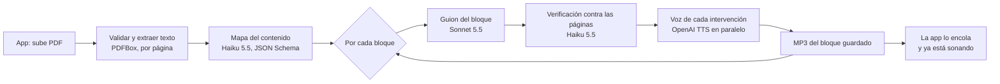

# podcastAI

Sube un PDF de estudio y dos IAs, **Lía** (presentadora) y **Marco** (experto), lo convierten en un podcast
conversado en tu idioma, fiel al contenido del PDF. El audio se genera por bloques de unos 60 segundos y
empieza a sonar en cuanto está el primero.

- **Backend:** Spring Boot 3.5 + Java 21 (hilos virtuales), JPA, Apache PDFBox, SDK oficial de Anthropic.
- **App:** Expo (React Native + TypeScript), funciona en Android, iOS y navegador.
- **IA:** Claude Haiku 5.5 para el mapa del contenido y la verificación, Claude Sonnet 5.5 para el guion.
- **Voz:** OpenAI `gpt-4o-mini-tts` (Lía con la voz `coral`, Marco con `ash`).

## Cómo funciona



1. **Subida y validación.** Se comprueba la cabecera `%PDF`, el tamaño (20 MB) y las páginas (100). El PDF no se
   guarda: solo su texto, identificado por su huella SHA-256.
2. **Mapa.** Una llamada devuelve título, temas (marcando los clave) y el plan de bloques con sus páginas.
   Se guarda en caché por PDF, modo e idioma.
3. **Guion por bloques.** Cada bloque recibe el mapa, solo las páginas que le tocan y el final del bloque anterior
   para que la conversación fluya. Salida estructurada: `{hablante, texto, páginas}`.
4. **Verificación.** Cada intervención se compara con sus páginas: `respaldada`, `parcial` (se corrige) o
   `sin_respaldo` (se elimina). El número de frases eliminadas se guarda como métrica de calidad.
5. **Voz.** Las intervenciones se sintetizan en paralelo con hilos virtuales (máximo 4 a la vez por podcast) y se
   unen en un MP3 por bloque. Se mide la duración real de cada frase para sincronizar la transcripción.
6. **Entrega.** La app consulta el estado y, en cuanto hay un bloque, muestra **Escuchar ya**. Al acabar un bloque
   pasa al siguiente; si aún no está, espera a que llegue.

## Arrancar en local

Necesitas **Java 21** y **Node 22**. No hace falta instalar Maven: el proyecto trae `mvnw`.

1. Copia `.env.example` a `.env` (en la raíz del proyecto) y rellena `ANTHROPIC_API_KEY`, `OPENAI_API_KEY` y
   `SIGNING_SECRET`. El backend lee ese archivo solo. Sin claves arranca en **modo de prueba**: el guion se arma con
   frases literales del PDF y el audio es silencio, para probar todo el flujo gratis.
2. Backend:

   ```bash
   cd backend
   ./mvnw spring-boot:run        # en Windows: mvnw.cmd spring-boot:run
   # → http://localhost:8080/actuator/health
   ```

   En el log verás `Guion con Claude…` y `Voz con OpenAI…` si ha encontrado las claves.
3. App (en otra terminal):

   ```bash
   cd app
   npm install
   npx expo start --web          # se abre en el navegador
   ```

Para probarla en el móvil con Expo Go, crea `app/.env` con la IP de tu ordenador en la red local y arranca
`npx expo start` (escanea el QR):

```
EXPO_PUBLIC_API_URL=http://192.168.1.50:8080
```

> Ninguna clave va en el código ni en la app. Solo el backend las lee.

## Variables de entorno

| Variable | Para qué | Por defecto |
|---|---|---|
| `ANTHROPIC_API_KEY` | Guion con Claude | vacía → modo de prueba |
| `OPENAI_API_KEY` | Voz con OpenAI | vacía → modo de prueba |
| `SIGNING_SECRET` | Firma de las URLs de audio (≥ 32 caracteres) | aleatorio en cada arranque |
| `REVENUECAT_WEBHOOK_SECRET` | Autoriza el webhook que activa el plan Premium | vacío → webhook desactivado |
| `CORS_ORIGINS` | Orígenes web permitidos | `*` |
| `DATABASE_URL`, `DATABASE_USER`, `DATABASE_PASSWORD` | PostgreSQL (por ejemplo Supabase) | H2 en `./data` |
| `STORAGE_DIR` | Carpeta de los MP3 | `./data/audio` |
| `PUBLIC_BASE_URL` | URL pública del backend, para las URLs de audio | la de la petición |
| `MAP_MODEL`, `SCRIPT_MODEL`, `VERIFY_MODEL` | Modelos de Claude | Haiku 5.5 / Sonnet 5.5 / Haiku 5.5 |
| `TTS_MODEL`, `TTS_HOST_VOICE`, `TTS_EXPERT_VOICE` | Voz | `gpt-4o-mini-tts`, `coral`, `ash` |
| `EXPO_PUBLIC_API_URL` (app) | Dirección del backend | `http://<host>:8080` |

## Planes y límites

- **Gratis:** un resumen (hasta 8 minutos) por cuenta. Si la generación falla sin producir audio, se devuelve.
- **Premium (10 €/mes):** 120 minutos al mes y el modo **A fondo** (12 a 20 minutos).
- El plan **solo** cambia por el webhook de RevenueCat (`POST /api/webhooks/revenuecat` con
  `Authorization: Bearer <REVENUECAT_WEBHOOK_SECRET>`), nunca por lo que diga la app.
- Los cupos se reservan con `UPDATE` atómicos, así dos peticiones a la vez no se saltan el límite.
- Máximo 6 podcasts por hora por cuenta (y 18 por IP).

Para probar Premium en local:

```bash
curl -X POST localhost:8080/api/webhooks/revenuecat \
  -H "Authorization: Bearer $REVENUECAT_WEBHOOK_SECRET" -H "Content-Type: application/json" \
  -d '{"event":{"type":"INITIAL_PURCHASE","app_user_id":"<id del dispositivo, visible en las peticiones>"}}'
```

## API

Todas las rutas llevan la cabecera `X-Device-Id` (id anónimo que la app genera y guarda en el llavero).

| Método | Ruta | Qué hace |
|---|---|---|
| `POST` | `/api/podcasts` | Multipart: `file` (PDF), `mode` (`RESUMEN` o `A_FONDO`), `language` (`es`, `en`, `ca`, `gl`, `eu`, `fr`, `de`, `it`, `pt`) |
| `GET` | `/api/podcasts` | Biblioteca del usuario |
| `GET` | `/api/podcasts/{id}` | Estado, bloques, transcripción con páginas y tiempos, métricas de verificación |
| `DELETE` | `/api/podcasts/{id}` | Borra el podcast y sus audios |
| `GET` | `/api/audio/{id}/{bloque}?exp=&sig=` | MP3 del bloque (URL firmada, caduca en 6 h) |
| `GET` | `/api/me` | Plan, minutos usados, podcasts gratis restantes |
| `DELETE` | `/api/me` | Borra la cuenta y todos sus datos (RGPD) |
| `POST` | `/api/webhooks/revenuecat` | Activa o termina Premium |

## Seguridad y privacidad

- Claves de IA y pagos solo en el backend, en variables de entorno.
- Cada usuario solo ve sus podcasts (hay tests que lo comprueban). El audio se sirve con URLs firmadas con HMAC.
- Validación del tipo real del archivo, tamaño y páginas; PDFs cifrados o escaneados se rechazan con un mensaje claro.
- Prompt injection: el texto del PDF va dentro de etiquetas `<fuente>` y los prompts dicen que es material, no órdenes;
  la salida estructurada y la verificación limitan lo que puede colarse.
- El texto de los PDF y los mapas se borran a los 30 días (tarea nocturna). Los logs no guardan texto del PDF.
- El id del dispositivo se guarda con `expo-secure-store`, nunca en AsyncStorage.

## Accesibilidad

Transcripción completa y sincronizada (resalta la frase actual, indica quién habla y la página del PDF, y se
puede descargar), etiquetas para VoiceOver y TalkBack, anuncios cuando hay un bloque nuevo, objetivos táctiles
de 48 px (play de 72 px), texto de 16 px que respeta el tamaño del sistema hasta el 200 %, contraste AA en modo
claro y oscuro, velocidad de 0,75x a 2x, ±15 s y controles en pantalla bloqueada. Sin animaciones.

## Tests

```bash
cd backend && mvn test        # flujo completo en modo de prueba, límites, aislamiento entre usuarios, MP3, verificación
cd app && npx tsc --noEmit    # tipos de la app
```

## Estructura

```
backend/   Spring Boot
  ai/        mapa, guion y verificación (Claude y modo de prueba), prompts
  pdf/       validación y extracción con PDFBox
  tts/       voz (OpenAI y modo de prueba), utilidades MP3
  podcast/   entidades, pipeline por bloques, almacenamiento, retención
  account/   planes y cupos
  web/       controladores REST, errores, límite de peticiones
app/       Expo Router
  src/app/   pantallas: biblioteca, nuevo podcast, reproductor, cuenta
  src/lib/   API, tema (paleta mate), id de dispositivo
```

## Qué falta (fase 2)

- Inicio de sesión con Supabase Auth (Google, Apple, correo) en lugar del id anónimo de dispositivo.
- Audio en Supabase Storage (cifrado, región UE) en lugar del disco local.
- Compra dentro de la app con RevenueCat (el backend ya tiene el webhook).
- Avisos por WebSocket en lugar de consultar el estado cada 1,5 s, y cola de trabajos con Redis.
- Modo Repaso tipo examen, voz premium con ElevenLabs, cambiar nombres y voces, OCR para PDFs escaneados.
